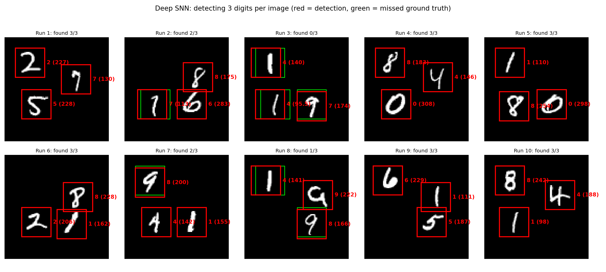
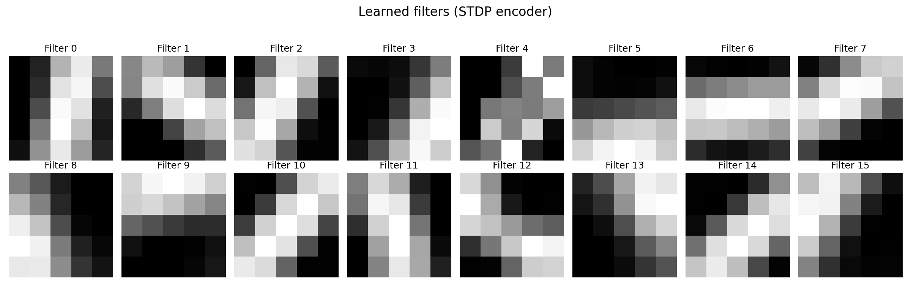
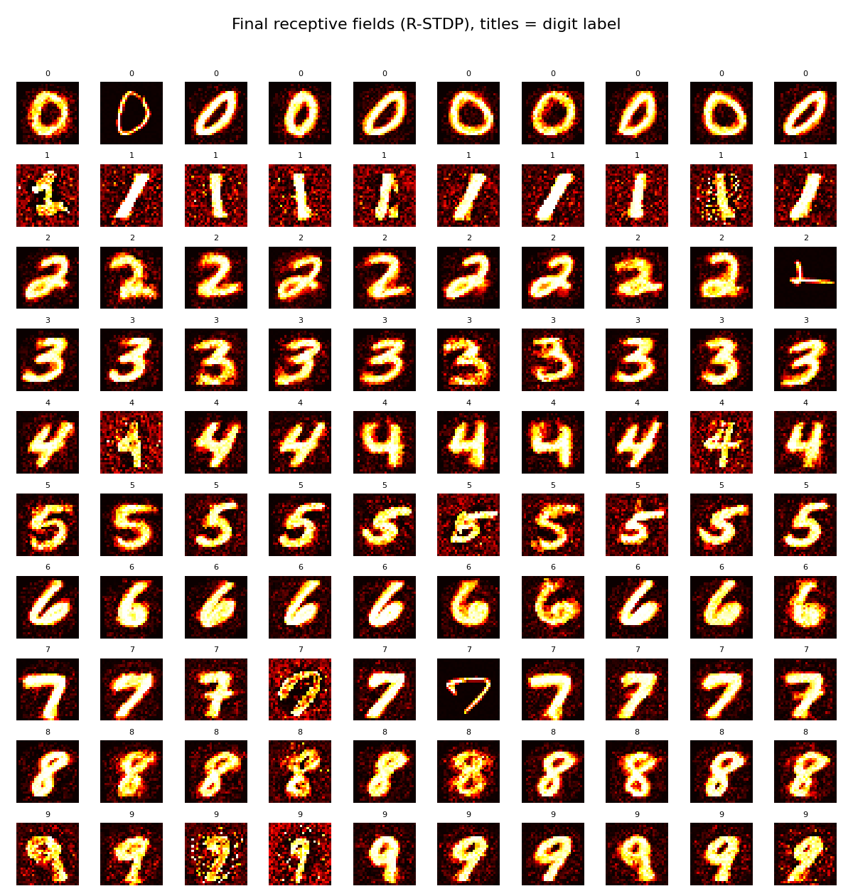

# Spiking Neural Networks for Bio-Inspired Digit Detection

Spiking neural networks (SNNs) written from scratch in **NumPy**, trained only with
**local, biologically plausible learning rules** (STDP and reward-modulated STDP), and
used as the classifier inside a **sliding-window object detector** for handwritten digits.

This code accompanies my (Aryan Abdollahpour's) B.Sc. thesis at **Amirkabir University of Technology (Tehran
Polytechnic)**, supervised by **Dr. Shariatmadar**. The goal was to see how far an SNN
can get on visual recognition without backpropagation, in a form that maps onto simple
hardware (additions, comparisons, local weight updates), e.g. an FPGA or a neuromorphic chip.

<p align="center">
  
</p>

## Features

- **Pure NumPy SNN core**: no deep-learning framework in the models (PyTorch is only used to
  download MNIST and for the comparison baselines).
- **Unsupervised feature learning**: a convolutional layer learns 16 oriented edge filters with
  STDP, winner-take-all lateral inhibition and weight normalisation (homeostasis).
- **Reward-modulated readout (R-STDP)**: a global +1/−1 reward signal, analogous to dopamine,
  gates Hebbian updates of the output layer.
- **Sliding-window detection** of several digits on a 100×100 canvas, with a boundary
  constraint against off-centre windows and IoU-based non-maximum suppression.
- **Event-driven single-layer SNN** of LIF neurons with adaptive thresholds and "smart"
  (sample-based) weight initialisation, which counters dead neurons.
- **Spike encoders**: rate coding, latency (time-to-first-spike) coding and a DoG retina filter.
- **Baselines**: a CNN and an snnTorch surrogate-gradient SNN for comparison.
- **Interactive GUI** that animates the trained network step by step.

## How it works

```
 MNIST image ──► STDP conv encoder ──► spike map ──► R-STDP readout ──► digit
  28 × 28        16 filters 5×5, WTA   16 × 24 × 24    10 neurons
                 (unsupervised)                       (reward ±1)

 100×100 canvas ──► 28×28 window, stride 2 ──► boundary check ──► SNN ──► voltage ≥ 93 ──► NMS ──► boxes
```

1. **Encoder (layer 1).** Each 5×5 location is a column of 16 neurons. The neuron whose filter
   gives the largest input current fires (winner-take-all) if it exceeds the threshold.
   During learning, every (active input, winning filter) pair is treated as a causal spike pair
   (Δt = 2 ms) and potentiated by `A+ · exp(−Δt/τ+)`. A small constant decay plays the role of
   depression, and each filter is renormalised to a fixed total weight.
2. **Readout (layer 2).** Output voltages are `W · spikes`; the most depolarised neuron wins.
   R-STDP applies `Δw = R · A+ · exp(−Δt/τ+)` to the winner's active synapses, with `R = +1` for a
   correct and `R = −1` for a wrong answer; on a mistake the correct neuron also gets `R = +1`.
3. **Detection.** The trained classifier scores every 28×28 window of the canvas. Windows with
   bright pixels in their 2-pixel border are rejected (they cut through a digit). Windows whose
   winning voltage is at least 93 become detections, and class-agnostic NMS (IoU ≥ 0.3) removes
   duplicates.

Both layers of the final model are evaluated in a single integrate-and-fire step per image,
which is why training on 11,000 images takes about 2 seconds. The single-layer and latency
models in this repo simulate full spike trains over time instead.

## Repository structure

```
├── snn_detection/                # importable package (shared code)
│   ├── deep_snn.py               # final model: STDP conv encoder + R-STDP classifier
│   ├── detection.py              # canvases, sliding window, IoU, NMS, evaluation
│   ├── single_layer.py           # event-driven 784→100 LIF network (STDP / R-STDP)
│   ├── latency_snn.py            # exploratory C1→S1→output network on latency-coded input
│   ├── encoding.py               # rate & latency spike encoders, DoG retina filter
│   ├── neurons.py                # adaptive LIF neuron, STDP rule
│   ├── baselines.py              # PyTorch CNN and snnTorch models
│   ├── visualization.py          # filter / receptive-field / detection plots
│   └── data.py                   # MNIST loader (NumPy arrays)
├── scripts/                      # command-line entry points (see "Usage")
├── notebooks/
│   ├── 01_building_blocks.ipynb          # DoG, encoders, LIF, pooling, conv-LIF layer
│   ├── 02_deep_snn_development.ipynb     # prototype → final model → detection
│   └── 03_detection_comparison.ipynb     # CNN vs snnTorch vs single-layer SNNs as detectors
├── weights/                      # trained weights (small, included)
│   ├── encoder_weights.npy       # 16 × 25 STDP filters
│   ├── classifier_weights.npy    # 10 × 9216 R-STDP readout
│   └── latency_snn.npz           # weights of the latency experiment
├── tests/                        # fast unit tests (pytest)
├── docs/images/                  # figures used in this README
├── requirements.txt
└── LICENSE
```

Generated files go to `outputs/` (figures) and `checkpoints/` (single-layer and baseline
models); MNIST is downloaded to `data/`. All three folders are git-ignored.

## Installation

Requires Python 3.10+ (tested with 3.11.9 on Windows 11; the code has no OS-specific parts).

```bash
git clone https://github.com/Arianabdl/snn-digit-detection.git
cd snn-digit-detection
python -m venv .venv
.venv\Scripts\activate          # Linux/macOS: source .venv/bin/activate
pip install -r requirements.txt
```

`pip install torch` installs a CPU or default CUDA build. For a specific CUDA version, follow
the selector at <https://pytorch.org/get-started/locally/>. A GPU is optional and only speeds up
the baselines. MNIST (~55 MB) is downloaded automatically on first use.

## Usage

All scripts run from the repository root and accept `--help`. Default seeds are fixed (`--seed 0`).

### Train and evaluate the final SNN

```bash
python scripts/train_deep_snn.py
```

Runs 1,000 images of unsupervised STDP and 10,000 images of R-STDP, prints the accuracy on 1,000
test images, overwrites `weights/*.npy` and saves `outputs/filters.png`
(`--no-save` keeps the existing weights).

```
Phase 1: unsupervised STDP on 1000 images...
Phase 2: supervised R-STDP on 10000 images (encoder frozen)...
  step 1000/10000 | accuracy on last 500: 86.40%
  ...
Test accuracy on 1000 unseen images: 92.10%
```

### Detect digits on a canvas

```bash
python scripts/detect_digits.py                    # uses weights/, 10 canvases with 3 digits
python scripts/detect_digits.py --runs 50 --retrain
```

Prints the true and detected labels per canvas plus totals, and saves
`outputs/detection_results.png` (red = detections with label and voltage, green = missed digits).
Options: `--stride`, `--threshold`, `--nms-iou`, `--digits`, `--match-iou`.

### Other experiments

| Command | What it does |
|---|---|
| `python scripts/train_single_layer.py --rule stdp` | Single-layer SNN, unsupervised STDP + random-sample initialisation, neurons labelled after training (~5 min on a laptop CPU) |
| `python scripts/train_single_layer.py --rule rstdp` | Single-layer SNN, R-STDP with 10 neurons per digit, targeted initialisation (< 1 min) |
| `python scripts/train_baselines.py --model cnn` | Train the CNN baseline (5 epochs) and report test accuracy |
| `python scripts/train_baselines.py --model snntorch` | Train the snnTorch baseline (5 epochs, 25 time steps) |
| `python scripts/train_latency_snn.py` | Latency-coded C1→S1→output network; loads `weights/latency_snn.npz` (`--retrain` is very slow) |
| `python scripts/demo_lif_neuron.py` | Plot an adaptive LIF neuron's response to a step current |
| `python scripts/demo_spike_encoding.py` | Raster plots of rate and latency coding for one digit |
| `python scripts/snn_visualizer_gui.py` | Tkinter GUI that walks through the network for random test digits (needs a display) |
| `python -m pytest` | Unit tests (no dataset needed, < 1 s) |

The single-layer and baseline scripts save models to `checkpoints/`; notebook 03 loads them from there.

### Notebooks

```bash
jupyter notebook notebooks/
```

Run 01 and 02 as they are. Before 03, train the four models it compares
(`train_baselines.py` for both models and `train_single_layer.py` for both rules). The notebooks
are committed with outputs from a full run.

## Results

MNIST accuracy on the first 1,000 test images (unless noted), from runs of this repository
with the default seeds, next to the values reported in the thesis.

| Model | Learning | This repo | Thesis |
|---|---|---|---|
| Single-layer LIF SNN (100 neurons) | unsupervised STDP + smart init | 42.2 % ¹ | 40.6 % |
| Single-layer LIF SNN (100 neurons) | R-STDP + targeted init (1k images) | 79.0 % | 77.9 % |
| **Conv SNN (final)** | **STDP + R-STDP** | **92.1 %** (script), 91.4 % (notebook 02) | 91.4 % |
| Conv SNN prototype (notebook 02, step 1) | Hebbian + backprop readout | 96.5 % (10k test images) | – |
| NumPy SNN (notebook 02, step 2) | Hebbian + delta rule | 94.4 % | – |
| CNN baseline | backprop | 98.4 % (98.7 % on 10k) | 98.7 % |
| snnTorch baseline | surrogate gradients | 98.3 % (97.8 % on 10k) | 97.2 % |

¹ Only 493 of the 1,000 test images produced a spike from a labelled neuron; accuracy on
those is 85.6 %. Digit "1" is never recognised (0 %), as in the thesis.

**Detection** (3 digits per canvas, stride 2, threshold 93, `scripts/detect_digits.py`):
23/30 digits found on the 10 default canvases. Over 50 canvases: 110/150 (73.3 %) with the
included weights and 115/150 (76.7 %) with `--retrain`. Almost all misses are
misclassifications (thin "1"s read as 4 or 7, some 9s read as 8) rather than missed locations.

**Detector comparison** (notebook 03; one run of 10 random canvases each, so treat these as
anecdotal): CNN 6/10, snnTorch 1/10, single-layer STDP on pre-screened digits 7/10, single-layer
R-STDP 3/10, R-STDP with purity filter 7/10, and R-STDP with purity filter on 3-digit canvases
18/30. The fully connected models (snnTorch, single-layer SNNs) are not translation-invariant.
They often give off-centre windows near-certain scores and pick the wrong box, which the purity
filter partly fixes.

The numbers vary by a few percent with the random seed; they come from single runs, not averages.

<p align="center">
  <br>
  <em>Edge filters learned by the unsupervised STDP encoder.</em>
</p>
<p align="center">
  <br>
  <em>Receptive fields of the single-layer R-STDP network (title = assigned digit).</em>
</p>

## Limitations and known issues

- **Simplified detection setting.** Canvases are black 100×100 images with MNIST digits at four
  fixed anchor positions; window size equals digit size (28×28), so there is no scale handling.
  This shows the SNN as a detector backbone, not a general object detector.
- **Rate-based approximation in the final model.** The deep SNN evaluates each layer in one
  integrate-and-fire step and treats coincident activity as a fixed Δt = 2 ms spike pair. It
  does not simulate spike timing. The R-STDP readout is supervised: the reward needs the label,
  and the correct neuron is also rewarded after a mistake.
- **Preprocessing.** The deep SNN is trained on raw pixels. The GUI applies the DoG retina
  filter before the trained network; the weights still work (90.8 % on 500 test images in the
  GUI's temporal mode).
- **GUI temporal readout.** Each location may spike only once per time window. The original GUI
  let locations fire repeatedly, which drops accuracy to about 28 %, because the readout was
  trained on one-winner-per-location spike maps.
- **The latency-coding experiment does not work yet.** The included `latency_snn.npz` was
  trained on only 100 images for the output layer. It answers 6 of 10 test images, all
  incorrectly. The loop-based simulation is too slow for larger training runs. It is kept as
  documentation of the experiment.
- **Single-layer quirk kept on purpose.** The last pre-synaptic spike times are not reset
  between images (as in the original implementation), so the first spikes of an image can pair
  with inputs of the previous one.
- The single-layer simulations are about 20× faster than the original loop code (vectorised),
  but sliding-window detection with them (notebook 03) still takes a few minutes.

## Author

**Aryan Abdollahpour** ([@Arianabdl](https://github.com/Arianabdl))

## Acknowledgements

B.Sc. thesis project, Amirkabir University of Technology
(Tehran Polytechnic), supervised by Dr. Shariatmadar. MNIST: Y. LeCun, C. Cortes and C. Burges.

## License

[MIT](LICENSE)
